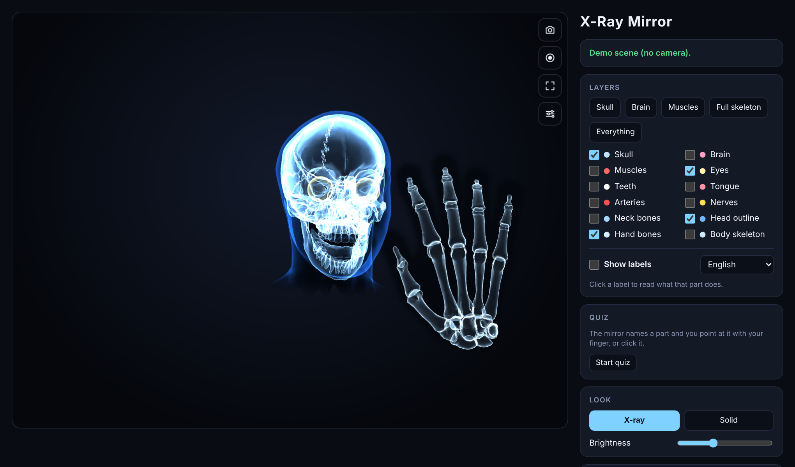
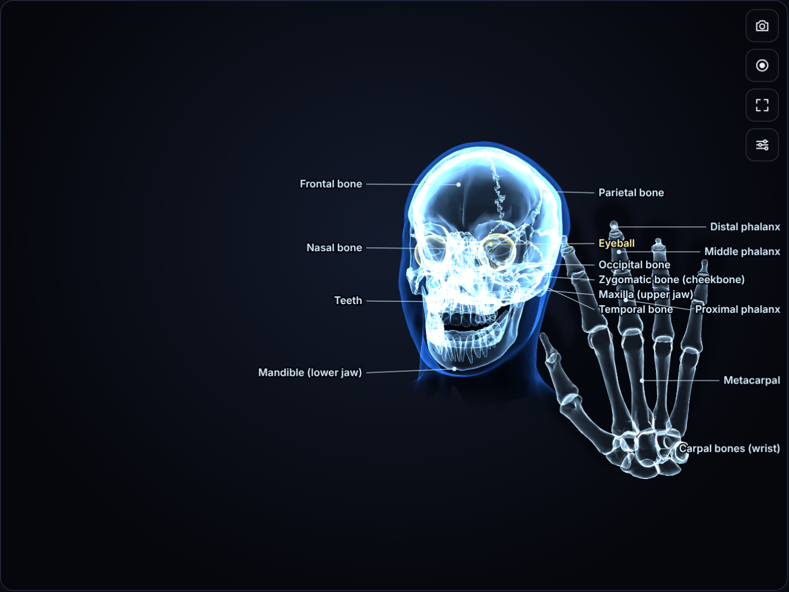
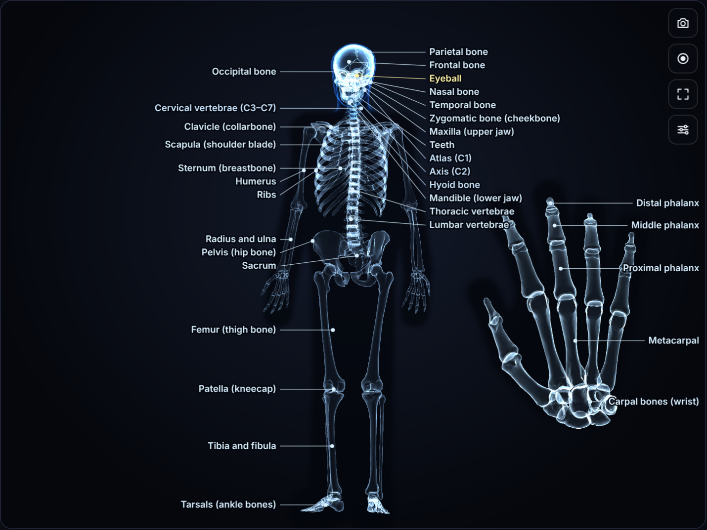
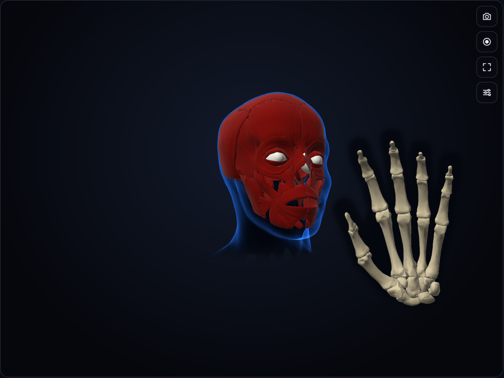
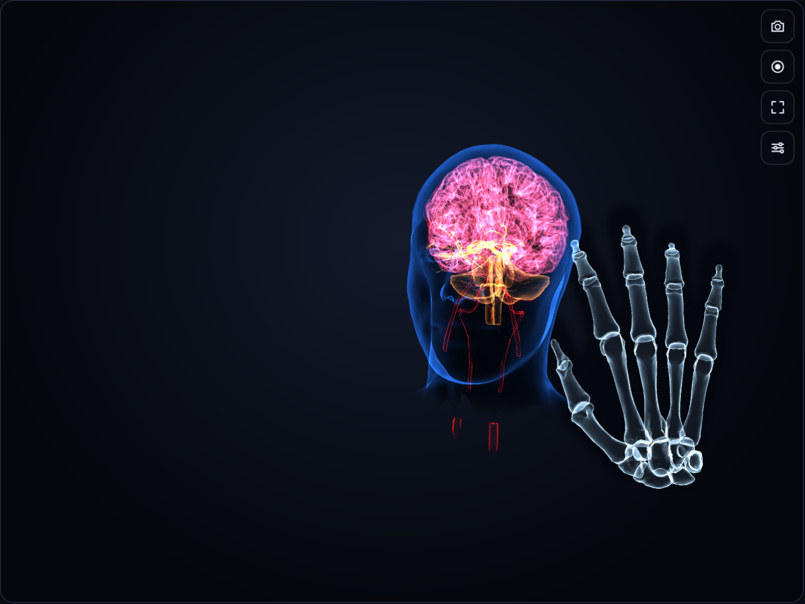
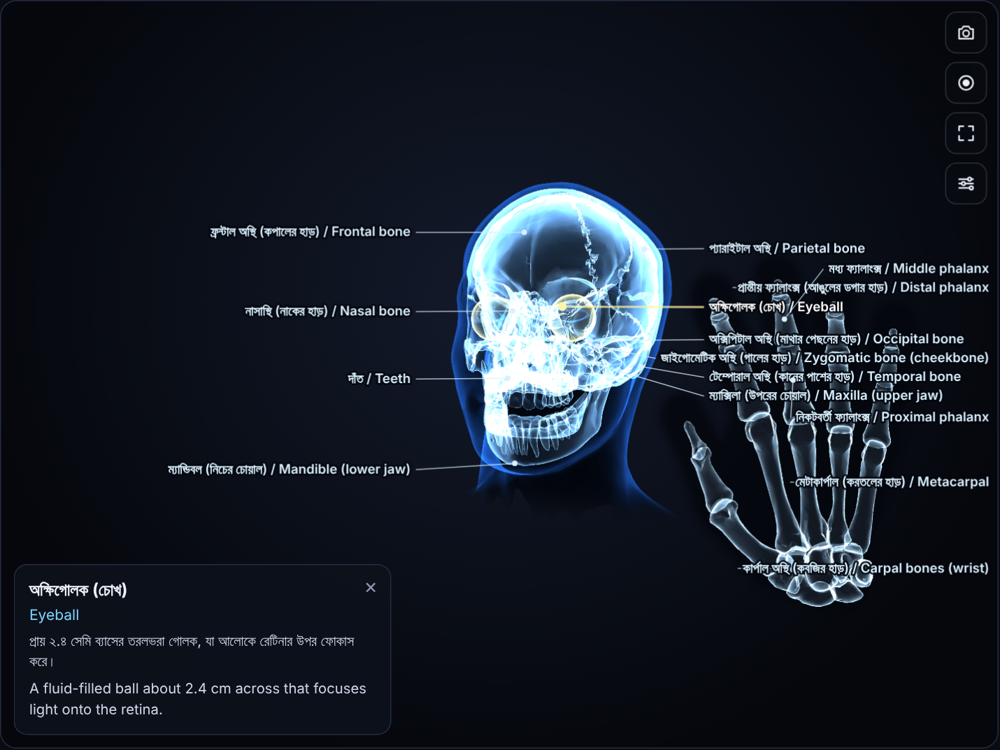
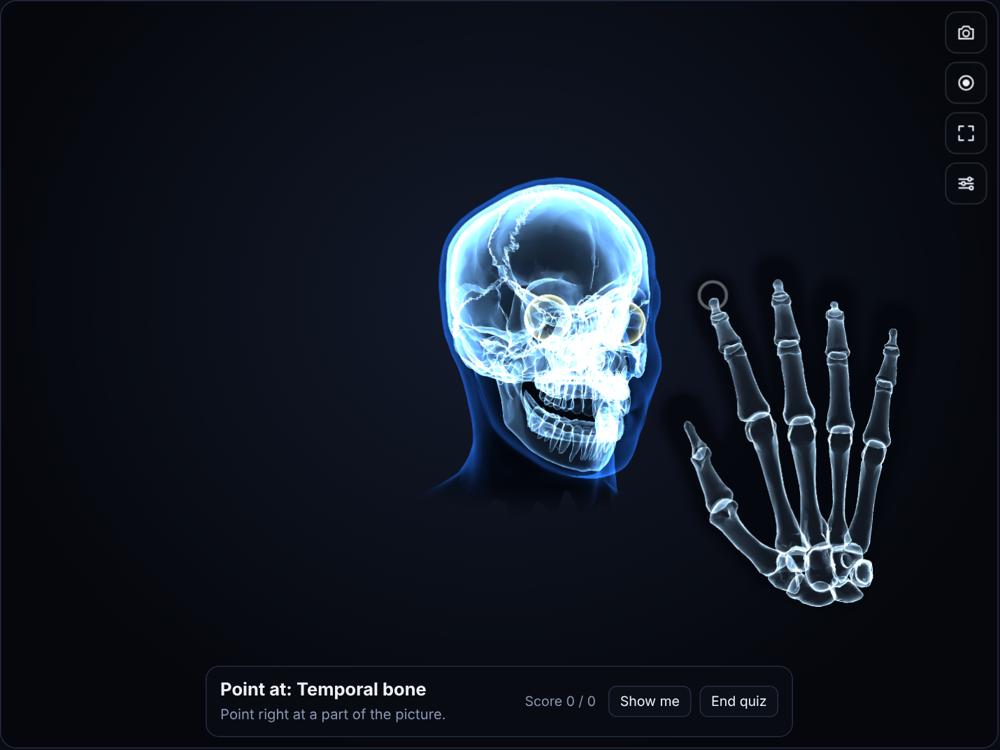

<div align="center">

# X-Ray Mirror

**See the skull, brain, muscles and skeleton inside your own body, live through your webcam.**

A single HTML file. No install, no account, no server. Your video never leaves your device.

[**Try the live demo**](https://x-ray-roy.netlify.app/) · [Demo scene without a camera](https://sowpnil-roy.github.io/X-Ray/X-Ray_Mirror%20.html#demo)



</div>

---

## What it does

X-Ray Mirror turns your camera into an anatomy mirror. It tracks your face, hands and body in real time and pins a real 3D anatomy model on top of you, so the skull turns when you turn your head, the jaw opens when you open your mouth, and the hand bones follow your fingers.

It is built for curiosity and for learning: every part can be labelled in English or Bangla, clicked for a short explanation, and practised in a built-in quiz.

## Screenshots

| | |
|:---:|:---:|
| <br>**Labels** on the skull and hand bones | <br>**Full skeleton** when you step back |
| <br>**Muscles** in the Solid look | <br>**Brain, arteries and nerves** in the X-ray look |
| <br>**Bangla + English** labels with an info card | <br>**Quiz mode**: point at the part it names |

*All screenshots are from the built-in demo scene, so no real person appears in them.*

## Features

### Anatomy layers
- **Head:** skull with a moving jaw, brain, facial muscles, eyes, teeth, tongue, arteries, nerves and neck bones
- **Hands:** all finger and palm bones, on up to four hands
- **Body:** rib cage, spine, pelvis, arms and legs when your shoulders and hips are in the picture
- One-click presets: Skull, Brain, Muscles, Full skeleton, Everything

### Two looks
- **X-ray:** glowing, see-through edges
- **Solid:** lit, opaque models
- Adjustable brightness, edge feather and how much of the real you shows through

### Learn
- **Labels** in English, Bangla, or both together
- **Info cards:** click any label to read what that part does
- **Quiz:** the mirror names a part and you point at it with your fingertip, or click it

### Reveal modes
- Whole head, left half, right half, top of the head, or lower face only
- **X-ray lens:** a round window that follows your index fingertip. Pinch to shrink it, spread your fingers to grow it

### Capture
- Save a **photo** (PNG) of exactly what is on screen
- Record a **video** (MP4 or WebM, depending on the browser) of up to 3 minutes
- Full-screen mode

### Camera and tracking
- Choose between cameras, with mirroring on or off
- Track **up to 3 people** at once
- Automatic, High or Low quality, so it stays smooth on slower devices
- Steadiness control to remove jitter
- **Auto-fit** matches the skull to the shape of your face, with manual sliders for fine-tuning
- **Works offline** after the first run: the 3D engine and trackers are saved in your browser
- Your settings are remembered between visits

## How to use it

1. Open the page and click **Start camera**, then allow camera access.
2. Face the camera with light on your face. The skull appears on your head.
3. Hold up a hand to see its bones.
4. Tick **Body skeleton** and step back until your shoulders and hips are visible to see the full skeleton.
5. Click **Auto-fit to my face** once while looking straight ahead for the best fit.

The first start downloads the 3D engine and trackers (about 23 MB, plus about 6 MB more the first time you turn on the body skeleton), so it takes a little while. After that it starts quickly and works without internet.

## Keyboard shortcuts

| Key | Action |
|:---:|---|
| `1` – `6` | Skull, brain, muscles, eyes, hand bones, body skeleton |
| `7` – `0` | Teeth and tongue, arteries, nerves, neck bones |
| `X` | Switch between X-ray and Solid |
| `L` | Labels on or off |
| `S` | Save a photo |
| `R` | Start or stop recording |
| `F` | Full screen |
| `C` | Next camera |
| `M` | Mirror on or off |
| `A` | Auto-fit to my face |
| `Q` | Start or end the quiz |
| `P` | Show or hide the controls |
| `Esc` | Close the info card |

## Run it yourself

The whole app is one file, `X-Ray_Mirror .html`.

**Quickest:** download `X-Ray_Mirror .html` and open it in Chrome or Edge.

**If the browser blocks the camera for a local file,** serve the folder instead:

```bash
git clone https://github.com/Sowpnil-Roy/X-Ray.git
cd X-Ray
python -m http.server 8000
```

Then open `http://localhost:8000/X-Ray_Mirror%20.html`.

**Demo scene:** add `#demo` to the address (for example `http://localhost:8000/X-Ray_Mirror%20.html#demo`) to see a test scene that needs no camera.

### Host it free on GitHub Pages

1. Push this repository to GitHub.
2. Go to **Settings → Pages**.
3. Under **Source**, choose **Deploy from a branch**, select `main` and `/ (root)`, then save.
4. After a minute the app is live at `https://sowpnil-roy.github.io/X-Ray/X-Ray_Mirror%20.html`.

Browsers only allow camera access on `https://` pages or `localhost`, and GitHub Pages is always `https://`.

## Browser support

| Browser | Status |
|---|---|
| Chrome, Edge (desktop and Android) | Recommended, and the browser family the app is tested in |
| Safari (macOS, iOS) | Expected to work. iPhone has no full-screen mode for web pages, so the full-screen button hides the controls instead |
| Firefox | Expected to work, not tested as thoroughly |

A device with a reasonably recent graphics chip gives the smoothest result. On slower devices the app drops to Low quality by itself.

## Privacy

All tracking and drawing happen in your browser, on your own device. The camera picture is never uploaded or stored anywhere. Photos and videos are saved only when you press the button, and only to your own downloads folder.

## How it works

| Part | Technology |
|---|---|
| Face, hand and body tracking | [MediaPipe Tasks Vision](https://ai.google.dev/edge/mediapipe/solutions/vision/face_landmarker) 0.10.14 (Face, Hand and Pose Landmarker) |
| 3D drawing | [three.js](https://threejs.org/) 0.160 with custom shaders for the X-ray and Solid looks |
| Anatomy models | [BodyParts3D](https://lifesciencedb.jp/bp3d/), simplified, re-aligned and packed inside the HTML file |
| Offline storage | IndexedDB (engine and tracker files), localStorage (your settings) |
| Capture | Canvas compositing and the MediaRecorder API |

The face tracker gives the position and rotation of your head, and the app then nudges the model so key points (eyes, nose, chin, cheeks) land exactly where the tracker saw them. Hand and body bones are stretched between the tracked joints. The torso is one mesh that bends to follow both shoulders and both hips.

## Project structure

```
X-Ray/
├── X-Ray_Mirror .html   the whole app: page, styles, code and 3D models
├── README.md
└── screenshots/          images used in this README
```

## Disclaimer

The anatomy is a real 3D dataset of one adult, scaled and pinned to your body. It shows where structures typically sit. It is not a scan of you and **it is not a medical tool**.

## Credits and license

- **Anatomy models:** BodyParts3D, © The Database Center for Life Science, licensed under [CC Attribution-Share Alike 2.1 Japan](https://creativecommons.org/licenses/by-sa/2.1/jp/). The models were simplified and re-aligned for this project, and those adapted models stay under the same license.
- **three.js:** MIT License
- **MediaPipe:** Apache License 2.0

---

## বাংলায় সংক্ষেপে

X-Ray Mirror আপনার ক্যামেরাকে একটি অ্যানাটমি আয়নায় পরিণত করে। এটি আপনার মুখ, হাত ও শরীর ট্র্যাক করে এবং তার উপর খুলি, মস্তিষ্ক, পেশি ও কঙ্কালের আসল 3D মডেল বসিয়ে দেয়।

- প্রতিটি অংশের নাম বাংলা ও ইংরেজিতে দেখা যায়, নামে ক্লিক করলে সেটির কাজ পড়া যায়
- কুইজ মোডে আয়না একটি অংশের নাম বলে, আপনি আঙুল দিয়ে সেটি দেখান
- ছবি ও ভিডিও সেভ করা যায়
- প্রথমবার চালুর পর ইন্টারনেট ছাড়াও চলে
- ভিডিও আপনার ডিভাইসেই প্রক্রিয়া হয়, কোথাও আপলোড হয় না

এটি শেখার জন্য তৈরি, কোনো চিকিৎসা-সরঞ্জাম নয়।
